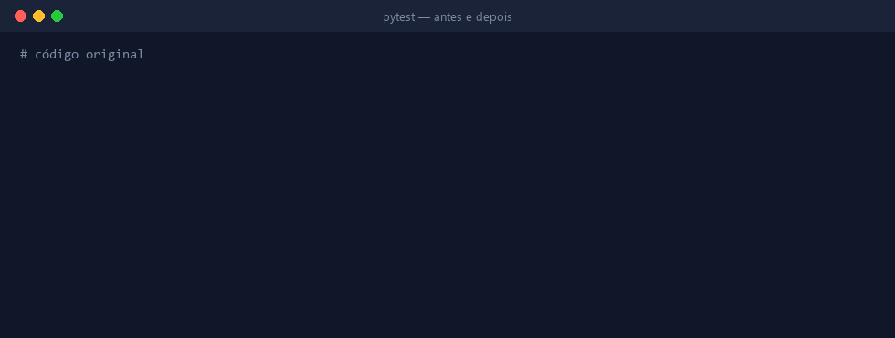
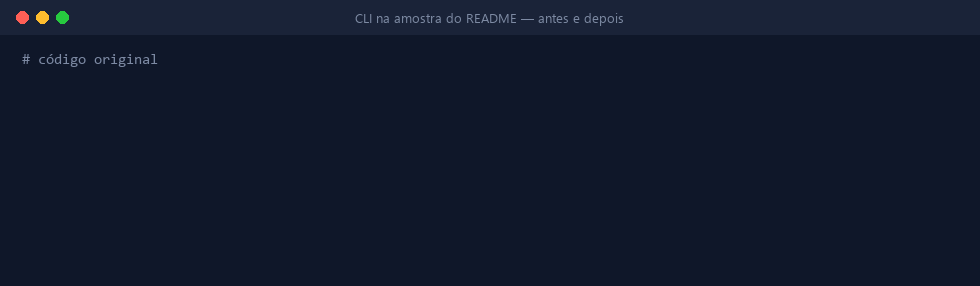
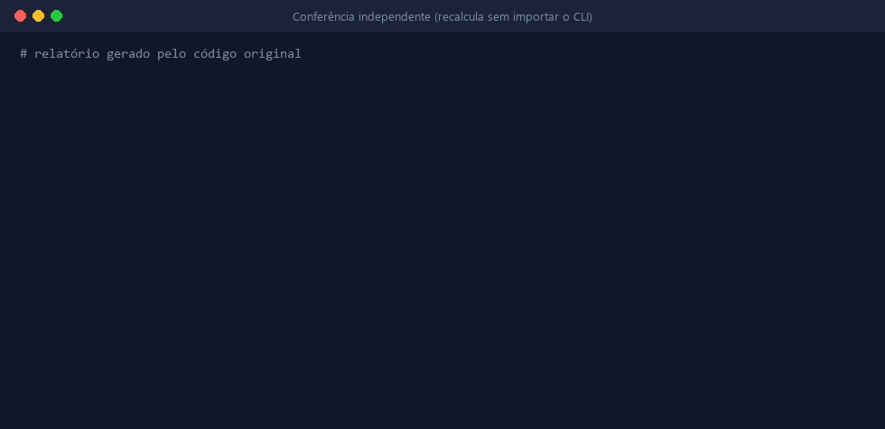

# Entrega — Consolidador de reservas de hotel

> Relatório técnico completo, com diagramas e gráficos: [`relatorio-tecnico.pdf`](relatorio-tecnico.pdf).
> Uso de IA: [`uso-de-ia/declaracao.md`](uso-de-ia/declaracao.md).

## Resumo

O CLI tinha **5 defeitos**, e todos distorciam o relatório. Cada um foi corrigido na causa raiz, sem alterar
os testes fornecidos, os argumentos do CLI, o schema do JSON nem os CSVs principais.

| | Antes | Depois |
|-|-|-|
| `pytest -q` (5 testes fornecidos) | 5 falham | 5 passam |
| `pytest -q` (suíte completa) | — | **63 passam** |
| Amostra: noites / total BRL / média | -33 / 5962.41 / 0.00 | **28 / 7566.00 / 270.21** (bate com o README) |
| Arquivo principal: reservas lidas | 200 de 300 | **300** |
| Arquivo principal: noites | -1393 | **1347** |
| Arquivo principal: total BRL | 193218.53 | **396170.00** |
| Arquivo principal: média por noite | 0.00 | **294.11** |
| Arquivo principal: 1º do ranking | H04 (o 5º menor) | **H06 — Hotel Salvador Centro** |

### Antes e depois, na prática

Saídas reais dos comandos, rodados no código original e no corrigido.

**Testes:** os 5 fornecidos falham no original; a suíte completa passa no corrigido.



**CLI na amostra do README:** o original chega a noites negativas; o corrigido bate com a tabela do README.



**Conferência independente:** o recálculo sem o código do CLI acusa divergência no relatório original e aprova o corrigido.



## Defeitos corrigidos

A coluna "Impacto isolado" mostra o resultado no arquivo principal se **só aquele** defeito existisse
(recalculado à parte; o valor correto é 300 reservas, 1347 noites e R$ 396.170,00).

| # | Defeito | Onde | Causa raiz (uma frase) | Impacto isolado |
|-|-|-|-|-|
| 1 | Leitura cortada | `repositories/csv_reservation_repository.py` | O loop de leitura tinha um `break` ao acumular 200 linhas, então as reservas 201–300 eram ignoradas. | 200 reservas, R$ 249.543,79 (−37%) |
| 2 | `NO_SHOW` faturável | `services/status_policy.py` | `is_billable` retornava `status != "CANCELLED"`, deixando `NO_SHOW` entrar em noites, valores, meses e ranking. | 1554 noites, R$ 460.058,83 (+16%) |
| 3 | Noites erradas | `services/stay_calculator.py` | A conta subtraía só o número do dia (`checkout.day - checkin.day`), que fica negativa na virada de mês ou de ano. | −1639 noites (71 reservas confirmadas viram o mês) |
| 4 | Câmbio invertido e impreciso | `services/currency_converter.py` | O valor era **dividido** pela taxa e convertido para `float`, quando a taxa é reais por unidade e o README exige `Decimal`. | R$ 237.031,25 (−40%; 93 reservas em USD/EUR) |
| 5 | Ranking invertido | `services/report_builder.py` | A chave de ordenação usava o total crescente, colocando os hotéis de **menor** valor no topo. | Top 5 = os 5 menores (H05, H04, H03, H01, H02) |

Correções:

1. Lê o arquivo inteiro.
2. `is_billable` retorna `status == "CONFIRMED"`. As contagens por status continuam vindo de todas as linhas, antes do filtro.
3. `(checkout - checkin).days * rooms`.
4. `amount * rate` em `Decimal`, sem `float` e sem arredondamento intermediário. O arredondamento half-up para 2 casas acontece só na serialização, como já era feito.
5. Chave `(-total_exato, hotel_id)`: total decrescente, empate por `hotel_id` crescente e `--top` aplicado depois.

## Melhorias de robustez (contrato de entrada inválida)

O README define o código `2` para entrada inválida. Alguns casos caíam no código `1` ("erro inesperado")
ou passavam em silêncio. Os dados fornecidos cumprem todas as regras abaixo, então **nenhum número mudou**
por causa delas.

Comportamento "Antes" medido rodando o código original com uma linha de cada caso:

| Situação | Antes (código original) | Depois |
|-|-|-|
| Moeda sem taxa na tabela | `KeyError`, código 1 | código 2, "moeda sem taxa de câmbio" |
| Taxa `NaN` | `InvalidOperation` na comparação, código 1 | código 2 |
| Taxa `Infinity` | código 0, total `"0.00"` | código 2 |
| Valor `NaN` | código 0, `total_amount_brl: "NaN"` | código 2 |
| Valor negativo | código 0, total `"-50.00"` | código 2 |
| Status desconhecido (ex.: `PENDING`) | código 0, faturado, mas fora das três contagens | código 2 |
| Check-out igual ou anterior ao check-in, quartos < 1 | código 0, noites zeradas ou negativas | código 2 |
| CSV com BOM (exportação de planilha) | código 2, "colunas ausentes" | lido normalmente (`utf-8-sig`) |
| `generated_at` injetado sem fuso ou em outro fuso | serializado como veio | normalizado para `-03:00` |

## Como foi investigado

1. **Linha de base antes de mexer em qualquer coisa.** Foram registrados Python 3.11.17,
   a saída do `pytest` (5 falhas) e os relatórios da amostra e do arquivo principal com o código original.
2. **Hipóteses tratadas como hipóteses.** Antes da implementação, uma leitura estática inicial
   levantou 5 suspeitas.
   Cada uma foi reproduzida com o código original antes de ser corrigida.
3. **Perfil dos dados.** O CSV principal foi conferido e é consistente: 3 status, 3 moedas, sem datas
   invertidas, IDs únicos, um nome por hotel e 16 reservas que viram o ano. Isso confirmou que os
   defeitos estavam no CLI e que validar a entrada não mudaria os números.
4. **Correção na causa raiz**, uma por arquivo, preservando o que já seguia o contrato: mês pelo
   check-in, contagem de status antes do filtro, média sobre os totais exatos e meses em ordem cronológica.
5. **Conferência independente.** [`scripts/conferir_relatorio.py`](../scripts/conferir_relatorio.py)
   recalcula o relatório só com a biblioteca padrão, **sem importar o código do CLI**, e compara campo a
   campo. Bate na amostra e no arquivo principal, e acusa divergência no relatório gerado pelo código
   original.
6. **Prova de que os testes protegem.** Cada defeito foi reintroduzido, um de cada vez,
   para verificar quais testes falhavam (tabela abaixo).

## Testes

Os 5 testes fornecidos estão **inalterados**. Foram adicionados 58 testes em `tests/test_extra_*.py`, com um
helper próprio (`tests/cli_runner.py`) para testar códigos de saída e stdout sem tocar no `helpers.py`.

| Arquivo | O que comprova |
|-|-|
| `test_extra_reading.py` | Leitura além de 200 linhas (a 201ª muda o ranking), CSV com BOM, 300 reservas no arquivo real |
| `test_extra_status.py` | `CANCELLED`/`NO_SHOW` fora de meses e ranking; sem confirmadas, média `"0.00"` e listas vazias |
| `test_extra_nights.py` | Virada de ano com 2 quartos, mês pelo check-in, meses em ordem cronológica |
| `test_extra_money.py` | EUR, soma exata com arredondamento único (3 × 0.005 → `"0.02"`), half-up (0.125 → `"0.13"`), média exata |
| `test_extra_ranking.py` | Empate por `hotel_id`, ranking pelo total exato (não pelo arredondado), soma por hotel, `--top` padrão 5 e menor que o pedido |
| `test_extra_cli_contract.py` | Schema e ordem das chaves, tipos, dinheiro como string com 2 casas, `-03:00`, stdout, `--output` padrão, códigos de saída 2 |
| `test_extra_units.py` | Regras isoladas: noites (inclusive ano bissexto), status, câmbio exato sem `float`, `format_money`, `generated_at` |

### Cada defeito reintroduzido é pego

| Defeito reintroduzido sozinho | Testes que falham |
|-|-|
| 1. Leitura cortada em 200 linhas | 2 |
| 2. `NO_SHOW` faturável | 4 (1 fornecido) |
| 3. Noites pelo dia do mês | 5 (1 fornecido) |
| 4. Câmbio dividindo via `float` | 7 (2 fornecidos) |
| 5. Ranking crescente | 5 (1 fornecido) |
| Extra: arredondar cada item antes de somar | 6 |
| Extra: multiplicar certo, mas via `float` | 2 |

Medido sobre a suíte final de 63 testes, restaurando o código corrigido após cada rodada.

O defeito 1 não é pego por nenhum teste fornecido. A última linha mostrou uma brecha real: a primeira
versão dos testes novos **não** detectava "multiplicar via `float`". Foram acrescentados dois testes de
exatidão (`1.1 × 1.1 = 1.21`, e um valor com 18 dígitos) e agora essa troca também é pega.

### Resultado do `pytest`

```text
$ python -m pytest -q
...............................................................          [100%]
63 passed in 11.06s
```

Só os testes fornecidos: `5 passed`. Ruff: `ruff check .` → `All checks passed!` e `ruff format --check .` sem pendências.

## Como validar

Requisitos: Python 3.11+.

```bash
python3.11 -m venv .venv
source .venv/bin/activate            # Windows (PowerShell): .venv\Scripts\Activate.ps1
pip install -r requirements-dev.txt

pytest -q                            # 63 passed
ruff check . && ruff format --check .

PYTHONPATH=src python -m onfly_report --input data/exemplo-validacao.csv --rates data/taxas_cambio.csv --output output/exemplo.json
PYTHONPATH=src python -m onfly_report --input data/reservas_hoteis.csv  --rates data/taxas_cambio.csv --output output/report.json --top 5

# conferência independente (sai com 0 se bater)
python scripts/conferir_relatorio.py --input data/reservas_hoteis.csv --rates data/taxas_cambio.csv --report output/report.json
```

No PowerShell, troque `PYTHONPATH=src` por `$env:PYTHONPATH = 'src'` em uma linha anterior.

Saída esperada no arquivo principal:

```text
Reservas: 300 | Confirmadas: 235 | Noites: 1347 | Total BRL: 396170.00
```

<details>
<summary>Relatório do arquivo principal (sem <code>generated_at</code>)</summary>

| `month` | `reservations` | `room_nights` | `total_brl` |
|-|-|-|-|
| 2024-12 | 35 | 174 | 61335.80 |
| 2025-01 | 37 | 235 | 64662.89 |
| 2025-02 | 26 | 138 | 45991.09 |
| 2025-03 | 39 | 215 | 65984.99 |
| 2025-04 | 21 | 146 | 31335.97 |
| 2025-05 | 39 | 196 | 63507.98 |
| 2025-06 | 38 | 243 | 63351.29 |

| `hotel_id` | `hotel_name` | `room_nights` | `total_brl` |
|-|-|-|-|
| H06 | Hotel Salvador Centro | 160 | 45165.46 |
| H10 | Hotel Madrid, Gran Vía | 120 | 45041.69 |
| H12 | Hotel Miami Beach | 106 | 41647.69 |
| H07 | Hotel Brasília Tower | 148 | 39920.52 |
| H11 | Hotel Buenos Aires | 102 | 37455.69 |

Resumo: 300 reservas, 235 confirmadas, 31 canceladas, 34 no-show, 1347 noites, total `396170.00` e média `294.11`.
</details>

### Um centavo que não é bug

A soma dos `total_brl` mensais dá **396170.01**, e o `total_amount_brl` é **396170.00**. Isso é
esperado: o README manda somar os valores exatos e arredondar **só na serialização**. Cada mês é
arredondado separadamente e o total é arredondado uma única vez sobre a soma exata. Somar os meses já
arredondados reintroduziria o erro que a regra evita.

## Decisões

- **`Decimal` do início ao fim** do dinheiro. `float` só aparecia no conversor e foi removido.
- **Validar em vez de descartar.** Uma linha inválida derruba o relatório com código 2 e a linha indicada.
  Descartar em silêncio mudaria `total_reservations`, que o README define como o número de reservas do arquivo.
- **O que já seguia o contrato foi mantido.** Isso inclui `format_money` (já era half-up), o agrupamento
  por mês do check-in, a média sobre totais exatos e o CLI (argumentos, `--top ≥ 1`, stdout e logs em stderr).
- **Mudanças pequenas e locais.** Cada correção ficou no arquivo da regra correspondente; a arquitetura não foi reorganizada.

## Histórico de commits

Os commits estão **agrupados por assunto** para facilitar a revisão, e não refletem a ordem cronológica
do trabalho. O primeiro commit é o código original do desafio, então o diff até o fim mostra exatamente
o que mudou. A ordem real da investigação está na sessão exportada em `uso-de-ia/`.

## Arquivos alterados e adicionados

- Alterados: `src/onfly_report/repositories/csv_reservation_repository.py`, `csv_rate_repository.py`,
  `src/onfly_report/services/status_policy.py`, `stay_calculator.py`, `currency_converter.py`,
  `row_parser.py`, `report_builder.py`.
- Adicionados: `tests/cli_runner.py`, `tests/test_extra_*.py` (7 arquivos), `scripts/conferir_relatorio.py`,
  `.github/workflows/ci.yml`, `entrega/`.
- Inalterados: testes fornecidos, `data/reservas_hoteis.csv`, `data/taxas_cambio.csv`, contrato do CLI e schema do relatório.
